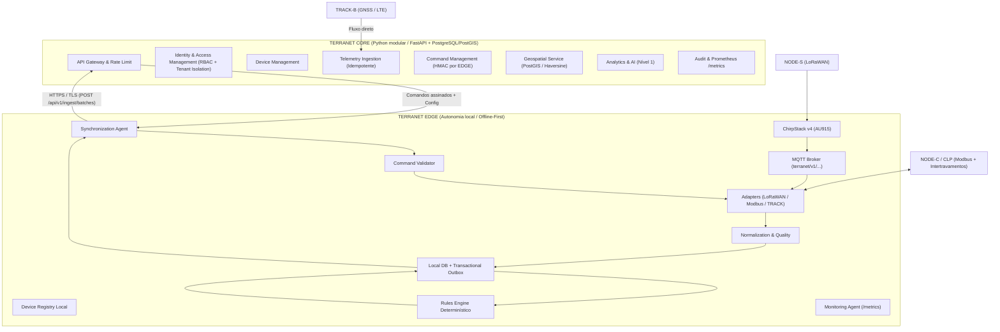

# E01 — Arquitetura de Software TERRANET AI (PIT-001)

## Princípio arquitetural

> Os dispositivos fornecem capacidades físicas; os adaptadores traduzem suas interfaces; o EDGE fornece autonomia operacional; e o CORE disponibiliza supervisão e inteligência em escala.

## Visão de componentes

## Mapeamento das decisões arquiteturais (ADRs)

| ADR | Implementação no repositório |
|---|---|
| ADR-001 | `edge/service.py`, `edge/storage/repository.py` — processamento e regras locais sem internet |
| ADR-002 | Pacotes independentes `edge/` e `core/` comunicando-se via contratos em `contracts/` |
| ADR-003 | `edge/adapters/` — interface `Adapter` com `ChirpStackAdapter`, `ModbusAdapter` e `TrackerAdapter` |
| ADR-004 | `contracts/canonical.py` e `contracts/schemas/telemetry_event.v1.json` |
| ADR-005 | `contracts/topics.py` e `edge/mqtt/bus.py` (QoS 1, retenção controlada, comandos nunca retidos) |
| ADR-006 | `edge/synchronization/client.py` e `core/api/app.py` (`POST /api/v1/ingest/batches`) |
| ADR-007 | `common/db.py`, `edge/storage/migrations/postgresql.sql`, `core/storage/migrations/postgresql.sql` |
| ADR-008 | `core/storage/migrations/postgresql.sql` (PostGIS `GEOGRAPHY(Point, 4326)` + GiST) e `core/geospatial/` |
| ADR-009 | `deployments/edge/`, `deployments/cloud/`, `demo/Dockerfile` |
| ADR-010 | SQLite WAL / PostgreSQL com `telemetry_events` e `sync_outbox` na mesma transação |
| ADR-011 | `ON CONFLICT (event_id) DO NOTHING`, backoff exponencial e dead-letter |
| ADR-012 | `edge/adapters/modbus/client.py` (`SimulatedPumpPLC`) — intertravamentos residem no CLP |
| ADR-013 | `core/identity/auth.py` (Bearer + RBAC + isolamento por tenant) e HMAC por EDGE em `contracts/commands.py` |
| ADR-014 | `edge/rules/engine.py` (regras determinísticas) e `core/analytics/service.py` (estatística/tendência/z-score) |
